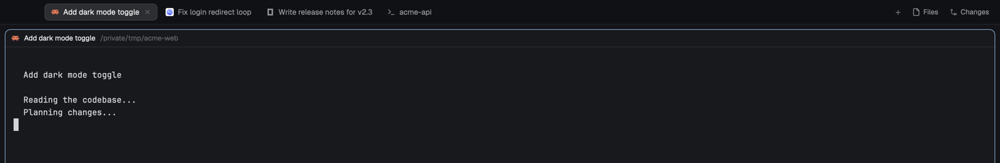

# Universal auto tabs

Tabs name themselves after what runs in them: a coding agent's conversation title (Claude Code, Codex, OpenCode, Grok Build, any program that sets a terminal title), else the program's name, else the shell's folder. Each space takes the name of the tab it shows, and the agents list shows each agent by its tab name alone. Names you type yourself always win until you clear them.

## What you see

- **Tab bar** (`auto-tabs`): Herdr's native tab bar, unchanged except that each tab's name may run to 280px before it truncates (native: 170px). Pills are 29px high, 12.8px text, the program's 14px icon before the name, a spinner while working, a 6px dot for blocked or done, and a close button on the active tab. On the right: `+`, Files and Changes.
- **Tab names**: a coding agent's tab reads as its conversation, e.g. "Fix login redirect loop". An agent with no title shows its program name ("OpenCode"). A shell tab shows its last folder ("acme-api"), `~` at home.
- **Space names** (Spaces sidebar, agents group headers): the active tab's name, e.g. "Add dark mode toggle".
- **Agents list** (`auto-agents`): Herdr's native agents list, but each row is the icon, the tab name (truncated to the row), time since its last change, and status. No space, repo or machine in the row.

## How it behaves

- Every 3 seconds the tab bar re-reads all spaces, tabs and panes and renames what changed. Nothing runs while no layout shows the `auto-tabs` bar.
- When an agent sets a new title, its tab follows within one poll. When the program exits to the shell prompt, the tab goes back to the folder name, ignoring any title the program left behind.
- In a split tab, the first pane with a useful title wins, then the first program name, then the first shell folder.
- Double-click a tab (or `tab.rename`) to name it yourself: the name stays through any title change. Rename it to an empty name to hand it back.
- Switching tabs renames the space to the newly shown tab. Renaming a space yourself keeps your name; an empty name hands it back. A space that has Herdr's own repo or folder name is taken over; another name already on a space counts as yours.
- Agent statuses look exactly as in Herdr: working shows a spinner, blocked a "Needs you" badge (or `!` under a section header), done a dot, idle a ring. Clicking a row focuses its pane, the icon folds sub-agents, hovering shows the pin.
- Tab selection, double-click rename, right-click menu, drag to move, close, scroll-to-switch, `+` menu, Files and Changes all work as in Herdr.

## Built from

- `mods/auto-tabs/`: a clone of Herdr 0.1.12's shipped `tabs` mod (`mod.json` `place: "none"`). `main.js` adds `import { syncNames } from "./names.js"`, `cx.timer.every(3000, () => syncNames())` in `init(_props, cx)`, `max_w(280)` on the name, and points the Windows window-button SVGs at `mods/auto-tabs/`. The four `win-*.svg` files are unchanged copies.
- `mods/auto-tabs/names.js` exports only `syncNames()`. It uses `spaces()`, `panes()`, `shared()`, `setShared()` and `run()` from `herdr`, and the commands `tab.rename` and `space.rename`. It runs no programs, reads no files and makes no network requests.
- `mods/auto-agents/`: a clone of Herdr 0.1.12's shipped `agents` mod. The row label is the tab's name (the live agent title for an unnamed tab or one named after its program), or the agent's program for an automatic tab number. The space name, the `· detail` suffix and the machine tag are removed. Its sort menu still opens the shipped `agents` mod as a popup.
- Installed into a layout by replacing the tab bar block's `"mod": "tabs"` with `"auto-tabs"` and the sidebar's `"mod": "agents"` with `"auto-agents"`.

### Name selection

| Rank | Pane | Name |
|---|---|---|
| 3 | Non-shell program with a useful title | The title, with known leading spinner glyphs and their space removed |
| 2 | Non-shell program without one | `program.name`, then `app` |
| 1 | Shell with a working directory | Last folder name; `/home/x`, `/Users/x`, `/root`, `C:\Users\x` are `~`; roots keep a root label |

A title equal to the program key, the app or the display name counts as no title. Mod panes and panes of closed tabs are ignored.

### Ownership

Records live in shared state: tabs under `tab-titles.set`, spaces under `space-titles.set`, keyed by id.

| Record | Meaning |
|---|---|
| `{mode: "auto", applied}` | Last confirmed automatic name (`null` before one) |
| `{mode: "manual"}` | Someone renamed it; leave it until it is cleared |
| `{mode: "pending", applied, from, target}` | A rename was sent; `from` is the `{named, name}` seen before it |

An unnamed tab or space starts automatic. A named tab with no record is adopted only when its name is a live program's display name (the launcher's default). A named space with no record is adopted only when its name is the last folder of the space folder or of one of its terminals. A pending rename is confirmed when live data shows the target. If the item is unchanged, the rename is resent every second poll. Any other change makes it manual. A legacy string record counts as an automatic name.

A space's wanted name is its active tab's automatic name while that tab is automatic or pending, else the tab's own name when someone named it.

## Watch out

- Herdr knows what runs in a terminal from its foreground process. A program started from a script without job control (e.g. `zsh -c 'prog; …'`) stays part of the shell's process group, so the tab shows the folder. Programs typed at a prompt, or started directly as the tab's command, are detected.
- Only titles a program publishes are used: the mod never reads conversations, arguments or session files. Titles such as Codex's "Topic | repo" keep their suffix.
- `tab.rename` and `space.rename` queue without acknowledgment or compare-and-set. A rename queued just before a manual rename can race it. A manual name identical to the last automatic name is indistinguishable from it.
- Selection is per screen, so two screens showing different tabs of one space would each pull the space name their way.
- Use one `auto-tabs` bar per layout: copies share records without a lock.
- Never pass an empty name to `tab.rename` or `space.rename`: Herdr then asks the person.

## Done when

- `herdr-app check` passes for `mods/auto-tabs` and `mods/auto-agents`.
- `node --experimental-vm-modules --test tests/names.test.mjs` passes all 27 tests (they load the real `names.js` with a mocked `herdr`).
- A new shell tab in `/tmp/acme-api` reads "acme-api" within 3 seconds.
- Running a program that sets the title "Fix login redirect loop" renames its tab to that; exiting it brings back "acme-api".
- Double-clicking a tab and naming it "Mine" keeps "Mine" while titles change; renaming it to "" brings automatic naming back.
- The space shows the active tab's name and changes when another tab is selected. A manual space name stays; clearing it brings the automatic name back.
- Agent rows show only the tab name, in the priority and grouped views alike.
