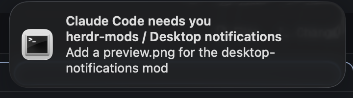

# Desktop notifications for Herdr

A [Herdr](https://herdr.dev) mod that sends Herdr's "needs you" and "finished" agent alerts to the system notification center (macOS Notification Center, or a Linux notification daemon), on top of Herdr's own sound and in-window toast.



- **Blocked:** "Claude Code needs you" whenever an agent needs you.
- **Done:** "Claude Code finished" when an agent finishes and you weren't looking. That means Herdr wasn't the front app, or the agent's tab wasn't the one shown.
- **Details:** each notification shows the space and tab, and the agent's conversation title.
- **Clean up:** a notification goes away once the agent moves on, and clicking it focuses that agent. Both need terminal-notifier.
- **Window:** the mod draws nothing. It lives in a 0px block.

It runs `terminal-notifier`, `osascript` or `notify-send` and `herdr-app`. It reads no files and makes no network requests.

## Install

Ask your Herdr agent to add this mod from its herdr.dev/mods page, or from `https://github.com/benjaminsicard/herdr-mods/tree/main/desktop-notifications`.

To install by hand:

```sh
git clone https://github.com/benjaminsicard/herdr-mods.git
cd herdr-mods/desktop-notifications
[ -e ~/.config/herdr-app/mods/desktop-notifications ] && echo "exists: compare before installing" \
  || cp -R mods/desktop-notifications ~/.config/herdr-app/mods/desktop-notifications
herdr-app check ~/.config/herdr-app/mods/desktop-notifications
```

Herdr docks a 0px block for the mod into the layout you're showing. If you use other layouts, add this block to each one:

```json
{ "type": "block", "content": { "mod": "desktop-notifications" }, "size": { "px": 0 } }
```

### macOS: recommended

```sh
brew install terminal-notifier
```

Then allow it in **System Settings → Notifications → terminal-notifier**. If it isn't installed or allowed, the mod falls back to `osascript`. Those notifications are attributed to Script Editor: clicking one opens Script Editor instead of Herdr, and they stay after the agent moves on.

### Options

Set props on the layout block to turn off one kind:

```json
{ "type": "block", "content": { "mod": "desktop-notifications", "props": { "done": false } }, "size": { "px": 0 } }
```

## Limits

- It only runs in layouts that contain its block.
- Windows isn't supported. Nothing is posted there.
- It can't set a dock badge, because Herdr gives mods no API for it.

## Verify changes

```sh
node --test tests/alerts.test.mjs
```

[RECIPE.md](RECIPE.md) is the build brief.
