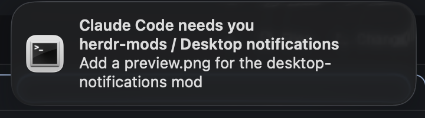

# Desktop notifications

When an agent needs you or finishes while you aren't looking, the alert also reaches your system's notification center, not just Herdr's sound and in-window toast. On macOS a banner reads "Claude Code needs you", with the space and tab under it, and stays in Notification Center until the agent moves on. Clicking it brings Herdr to the front on that agent. Herdr itself draws nothing new.



## What you see

- **Nothing in the window.** The mod sits in a 0px block (`size: { px: 0 }`) and draws an empty `div`.
- **A system notification** per alert:
  - Title: `<program> needs you` (blocked) or `<program> finished` (done), where `<program>` is the program's display name, e.g. "Claude Code", "Codex", "OpenCode", else its reported app, else "An agent". These match Herdr's own toast titles.
  - Subtitle: `<space> / <tab>`, or just one of them when they are equal or one is empty.
  - Body: the agent's terminal title (usually its conversation title), else the tab name, else the program name.
- No sound of its own. Herdr already plays its blocked or done sound.

## How it behaves

- **Blocked:** an agent that changes to `blocked` posts a notification, even if you are looking at it. This matches Herdr's sound, which also always plays for blocked.
- **Done:** an agent that goes from `working` or `blocked` to `done` or `idle` posts a notification only if you weren't looking. Looking means the Herdr window is the active app and the agent's tab is the shown tab. So an agent that finishes in front of you while you are in another app still notifies.
- **Working / idle:** nothing is posted. When an agent that has a notification goes back to `working` or `idle` (you looked at it, or answered it elsewhere), or disappears, its notification is removed from Notification Center. This works with terminal-notifier only.
- **One per agent:** a new notification for the same agent replaces the old one.
- **Click** (terminal-notifier only): runs `herdr-app do agent.focus '{"terminal":"<address>"}'` and activates `dev.herdr.app`, so Herdr comes to the front on that agent, across spaces and machines.
- **Startup:** the first read only records statuses, so agents that were already blocked or done when Herdr started don't notify.
- Sub-agents never notify; their parent does, as in Herdr.
- Agents on other machines (`vps/t7`) notify the same way.

## Built from

- `mods/desktop-notifications/mod.json`: `{ "place": "bottom", "size": 0, "title": "Desktop notifications" }`. On first sight Herdr docks one 0px block with `content: { "mod": "desktop-notifications" }` into the shown layout.
- `main.js` (the `View`):
  - Reads `agents()`, `terminals()` (entries with a `parent` are sub-agents), `focused()` (`space`, `tab`), `window()` (`active`, `platform`) and `props()`.
  - Checks on every `render` (live data changed) and on `cx.timer.every(2000)`, so it keeps working when its block is hidden.
  - Delivers with `exec`:
    - macOS: `terminal-notifier -title … -subtitle … -message … -group herdr-agent-<address> -activate dev.herdr.app -execute "<herdr-app path> do agent.focus '{…}'"`, and `terminal-notifier -remove herdr-agent-<address>` to clear. If terminal-notifier is missing, or exits non-zero (for example because macOS doesn't allow it to notify), that one notification goes through `osascript` (`display notification … with title … subtitle …`), and the next one tries terminal-notifier again.
    - Linux: `notify-send --app-name=Herdr --urgency=critical|normal <title> <subtitle>\n<body>`.
    - Windows: nothing.
  - Finds programs once with `/bin/sh -c 'command -v …'`, including `herdr-app`'s path for the click action.
- `alerts.js`: pure functions, with no `herdr` import:
  - `alertFor(prev, next, looking)`: Herdr's attention rule from `herdr-app`'s `Model::alert`.
  - `isLooking(agent, focus, windowActive)`.
  - `message(agent, alert)`.
  - `diff(known, agents, ctx)`: returns `{ known, post, clear }`.
- Props (optional, on the layout block): `{ "blocked": false }` or `{ "done": false }` turns that kind off. Both are on by default.
- No art, keys, network or files.

## Watch out

- A mod only runs while a layout shows its block. A fresh build docks into the layout shown when the folder first appears. Other layouts (`terminals`, `win98`, your clones) need the same 0px block added by hand, or they won't notify.
- One block per layout. Two copies post twice.
- On macOS, `osascript` notifications are attributed to Script Editor: clicking one opens Script Editor, not Herdr, and they can't be removed later. Install terminal-notifier (`brew install terminal-notifier`) for click-to-focus and auto-clearing.
- terminal-notifier has to be allowed in System Settings → Notifications → terminal-notifier. Until it is, it exits with code 3 ("Notifications are not allowed for this application") and each notification falls back to osascript. On macOS 26 a Homebrew install may not show up in that list at all: register it with `lsregister -f` on its `.app` and `open` it once to get the permission prompt.
- Don't detect "looking" with `agent.focused` alone. Herdr treats every agent in the shown tab of the active window as seen, so a split pane next to the focused one doesn't count as finished-while-away.
- `exec` runs with the user's real PATH. The `-execute` string runs under terminal-notifier's own shell, so it needs `herdr-app`'s absolute path.
- No dock badge: mods can't set one.

## Done when

- `herdr-app check ~/.config/herdr-app/mods/desktop-notifications` passes.
- Run a fake agent in a tab you aren't showing. It goes idle, then working, then blocked, then working, then done:

  ```sh
  st() { printf '\033]7501;state=%s\033\\' "$1"; }; st idle; sleep 4; st working; sleep 4; st blocked; sleep 8; st working; sleep 4; st done; sleep 600
  ```

  You get "sh needs you" when it blocks, that notification goes away when it works again (terminal-notifier only), and "sh finished" arrives at the end.
- The same agent finishing in the shown tab, with Herdr in front, posts nothing. With another app in front, it posts "finished".
- With terminal-notifier, clicking the notification brings Herdr forward on that agent's tab.
- `node --test tests/alerts.test.mjs` passes: 10 tests.
